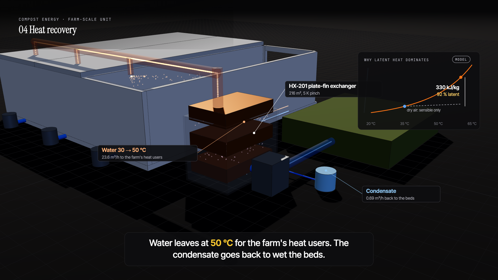
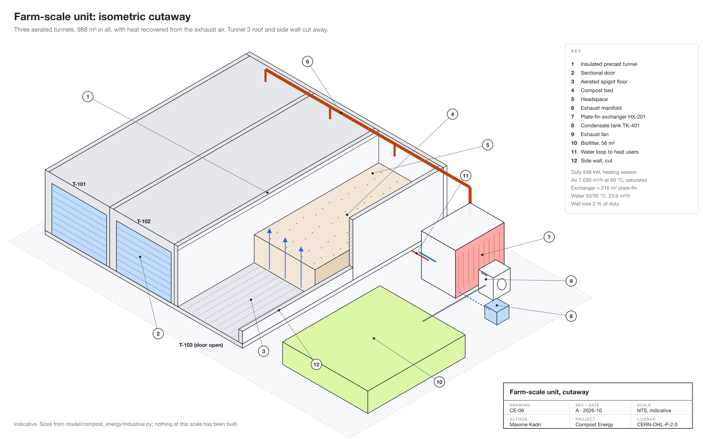

<picture>
  <source media="(prefers-color-scheme: dark)" srcset="assets/brand/banner-dark.png">
  
</picture>

# Compost Energy

[](https://github.com/esp75/compost-energy/actions/workflows/ci.yml)


**Open hardware for recovering heat from farm compost.** Enclosed, aerated tunnels compost manure and straw; the hot, saturated exhaust air is condensed on a plate-fin exchanger, and the heat goes to a greenhouse, a dryer or a small heat network.

> **Start here:** [docs/](docs/README.md) is organised as [Diátaxis](https://diataxis.fr/): [tutorials](docs/tutorials/run-the-model.md) to run the model, [how-to guides](docs/how-to/), [reference](docs/reference/farm-unit.md) for the numbers, and [explanation](docs/explanation/pivot.md) for why the design is what it is.

It started in 2024 as a home "biological boiler" with one chamber per composting phase. The numbers didn't add up for homes, so it moved to farm scale. This repo is the full engineering record: the (now open) patent, the energy model at three scales, the configuration study that chose the farm layout, drawings, a CAD model, a physics simulation of a prototype run, the data pipeline for real logger data, and the logger firmware. Every number is labelled MODEL, SIMULATED or MEASURED.

## Farm-scale unit

[](video/README.md#farm-scale-unit-product-demo-98-s)

Four aerated tunnels, each running a whole 15-day batch in place, started 3.75 days apart, with heat recovered from the exhaust air: **548 kW** mean (630 kW peak) over the heating season, **2 GWh/yr**, through an 85 m³ buffer tank. The design is sized from the energy model in [`industrial.py`](model/compost_energy/industrial.py), drawn as [CE-06 to CE-14](hardware/drawings/), modelled in [CadQuery](hardware/cad/) (STEP, GLB, STL), and shown in a demo rendered from that CAD model. 92 % of the recovered heat is water vapour condensing, and the walls lose 2 %. → [docs/farm-unit.md](docs/reference/farm-unit.md)

**Why four tunnels?** A [configuration study](docs/explanation/configuration-study.md) compared 2, 3 and 4 tunnels, moving batches between tunnels with a loader, an automatic transfer train (walking floors or a winch-pulled floor net, fill only tunnel 1), and the patent's stacked chambers built as a tower. Four tunnels whole-cycle-in-place came out best at low, base and high costs: about **€0.68M capex** and **€42k/yr after repaying it** over 10 years (MODEL). The automatic train is engineered and kept on record ([CE-13](hardware/drawings/farm-transfer-train.svg)); it loses about €100k/yr because the loader work it replaces is small.

**Why only 15 days in a tunnel?** The tunnel holds the stage that has to be enclosed: about 4 mesophilic days, then about 11 thermophilic days (held at 60 °C, sanitised by 72 h at ≥ 55 °C, then cooled to 45 °C). That is where two thirds of the organic matter breaks down, where the heat is and where the smell is. The batch then matures for 8 weeks in windrows. Roof spray bars hold the bed at 50–60 % moisture, with condensate until the batch is sanitised and farm water after it. Recipe, process window and water per batch: [docs/process.md](docs/reference/process.md), [CE-14](hardware/drawings/farm-process-sheet.svg).




## Watch: how compost makes heat (3.5 min)

[](video/compostito-explainer.mp4)

What compost is, aerobic vs anaerobic, what the microbes need (C:N, moisture, air, size), why they get hot, the four phases, where the project started (Compostito, the home unit), the farm tunnel and its 15-day batch, heat and water, and why aerobic compost makes a better fertiliser. Captioned, no voice ([script](video/narration-script.md), [subtitles](video/compostito-explainer.srt)). Rendered from code in [`video/src/`](video/src/).


More drawings (build drawing, exchanger coil, P&ID, farm layout): [`hardware/drawings/`](hardware/drawings/).

## The short version

1. **2024:** designed a home unit that turns food scraps into heating and fertiliser. Wrote a provisional patent, specified three prototypes (~€640 BOM) and sized the heat exchanger.
2. **The numbers didn't work for homes.** A household's waste is worth **~59 W** of heat on average. A 50 W fan and controller make it net-negative, and the exchanger had been over-estimated ~70× by one wrong assumption ([details](docs/reference/heat-exchanger.md)).
3. **They do work at farm scale.** About 14,000 t/yr of farm feedstock yields **~2 GWh/yr** of heat, worth **~€157k/yr net** before capital, and four tunnels with heat recovery cost about €0.68M (MODEL). Microbial heat grows with volume while losses grow with surface area. → [pivot.md](docs/explanation/pivot.md)


## Simulated prototype run

> ⚠️ **Everything in this section is SIMULATED.** Nothing here was measured. The data comes from a physics model of a 200 kg insulated prototype ([`simulate.py`](model/compost_energy/simulate.py)), with realistic sensor faults injected. It shows what the prototype should do if the physics is right, and it exercises the same pipeline that real logger data will go through. Real runs will go in [`data/measured/`](data/measured/).

The model: two microbial populations (mesophilic + thermophilic) with cardinal-temperature kinetics, first-order substrate decay, a lumped energy balance (walls, buoyant ventilation, turning losses) and an effectiveness-NTU exchanger. Energy is conserved to machine precision (tested).

| | |
|---|---|
|  |  |

- Core reaches **65 °C** by day 3, stays above 55 °C for **8.5 days** (enough for pathogen kill), re-heats after the day-9.5 turning, and matures to ambient.
- The loop recovers **12.4 kWh over 45 days**: about 84 W while pumping, with a 3.4 °C outlet rise at 0.35 L/min.
- **Only ~9% of the microbial heat is recovered.** The rest leaves through the walls and vents:


**Data cleaning.** The raw log includes DS18B20 error codes (−127/85 °C), a sensor stuck for 1.5 days, flow-meter spikes, logger power cuts, duplicate rows and out-of-order timestamps. The pipeline removes them and leaves long gaps empty rather than inventing data. Energy computed from the cleaned noisy log: **12.42 kWh, against 12.41 kWh true** (0.1% error).


## Checked against real measurements

The simulation is only useful if it matches reality, so this repo also includes two published, openly licensed (CC-BY-4.0) datasets **measured by other research groups**. They are included unmodified with full attribution in [`data/reference/`](data/reference/). They are not Compost Energy measurements.

**Bin scale.** These are temperature logs from three ~320-390 kg compost bins (Collins & Stacey, 2021). The real bins run hotter and stay hot longer than the simulation (peak 75-76 °C vs 65 °C; 10-14 days above 55 °C vs 8.5). Manure-rich feedstock and an aeration plenum are the likely reasons, so the simulated box is conservative. The data also had a real sensor fault: a probe reading a fixed 537 °C for two days. The repo's cleaning rules removed it, and the data showed that the "stuck sensor" rule doesn't suit coarse-resolution loggers.


**Farm scale.** This is an enclosed composter on a 150-cow dairy farm with an exhaust-air heat exchanger (Kojima et al., 2022). **38% of the microbial heat reached the water** (23.3 of 61.8 kW), against ~9% in the simulated 200 kg box. That measured gap is the scale effect behind the [pivot](docs/explanation/pivot.md). The facility also drew 13.3 kW of electricity for aeration and agitation, which is the cost side the energy model accounts for.


## Repository

```
docs/                 Diátaxis: tutorials, how-to, reference, explanation (start at docs/README.md)
  tutorials/         run the model and the simulation, step by step
  how-to/            add measured data; change a design assumption
  reference/         farm-scale unit, system design, composting process, heat exchanger, 2024 patent
  explanation/       energy model, why farm scale, configuration study, timeline
hardware/
  cad/               farm-scale unit in CadQuery: STEP, GLB, STL, parts list (generated)
  bom/               prototype 1-3 bill of materials
  drawings/          CE-01..13: home unit, prototype, farm unit, P&IDs, controls, configuration study (generated)
  logger/            ESP32 + DS18B20 logger firmware and wiring (not yet built)
model/
  compost_energy/    energy_balance, heat_exchanger, industrial, configurations, simulate, clean
  scripts/           run_scenarios, run_configurations, run_process, simulate_run, analyze_run, compare_reference
  tests/             35 tests: scenario numbers, energy conservation, cleaning, reference data, configurations
video/               product demo + explainer: captions, posters; src/ renders both frame by frame
brand/               logo, colour, type, voice, assets and the brand book; src/ regenerates all of it
data/
  model/             configurations.json: every option at low, base and high costs
  simulated/         raw_run_01.csv (noisy log), clean_run_01.csv, truth, ledger, report
  measured/          real runs go here
  reference/         third-party measured datasets (CC-BY-4.0), with citations
figures/             generated
```

## Reproduce

```bash
python3 -m venv .venv && .venv/bin/pip install -e "model[test]"
.venv/bin/python model/scripts/run_scenarios.py                 # energy model + exchanger figures
.venv/bin/python model/scripts/simulate_run.py                  # writes data/simulated/raw_run_01.csv
.venv/bin/python model/scripts/analyze_run.py data/simulated/raw_run_01.csv
.venv/bin/python model/scripts/compare_reference.py             # vs published measurements
.venv/bin/python model/scripts/run_configurations.py            # configuration study + figures
.venv/bin/python model/scripts/run_process.py                   # phases, moisture, water per batch
.venv/bin/python hardware/drawings/src/make_drawings.py         # CE-01..13 (PNGs need: cd video/src && npm install)
.venv/bin/python -m pytest model/tests
.venv/bin/pip install -e "model[cad]" && .venv/bin/python hardware/cad/farm_unit.py   # CAD model
```

## Roadmap

- [ ] Build prototype 2 and the logger; first measured run in `data/measured/`
- [ ] Prototype 3 (double exchanger length): measure how output scales with area
- [ ] Fit the simulation's kinetic and loss parameters to measured data (start with the Collins bins)
- [x] Dimensioned drawings and coil layout ([drawings/README](hardware/drawings/README.md)); re-dimension after the first build
- [x] Farm-scale concept: tunnels, exhaust-air heat recovery, controls, CAD ([farm-unit.md](docs/reference/farm-unit.md))
- [x] Configuration study: 2-4 tunnels, loader and automatic transfer, stacked tower ([configurations.md](docs/explanation/configuration-study.md))
- [x] Process sheet: recipe, mesophilic/thermophilic/maturation phases, sanitisation, moisture and spray water ([process.md](docs/reference/process.md))
- [ ] Log one full-scale batch's exhaust heat hour by hour: it settles 3 vs 4 tunnels
- [ ] Farm pilot: a partner site with a nearby heat user

## License

Hardware CERN-OHL-P v2 · docs and data CC-BY-4.0 · code MIT · the logo is not licensed. See [LICENSE.md](LICENSE.md).

Maxime Kadri, physics (Lyon). Designed in 2024; opened in 2026.
