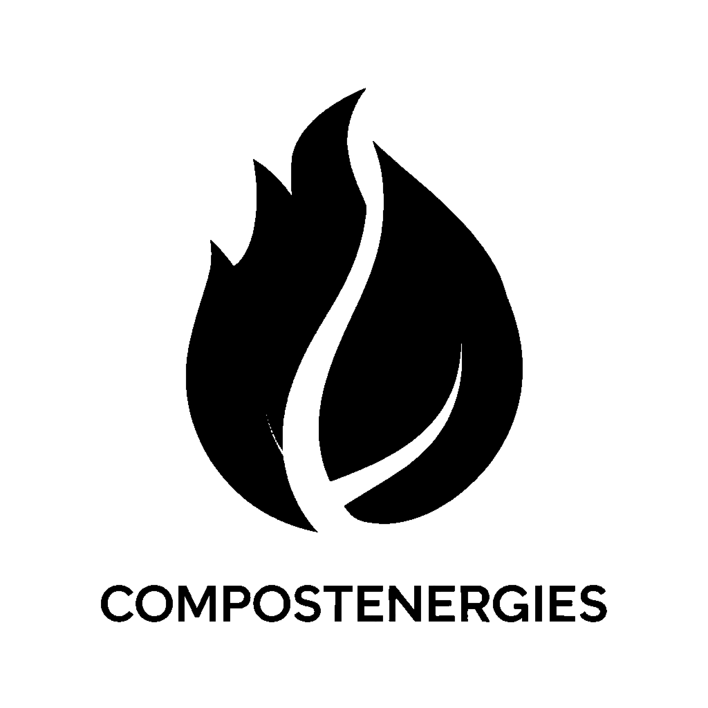
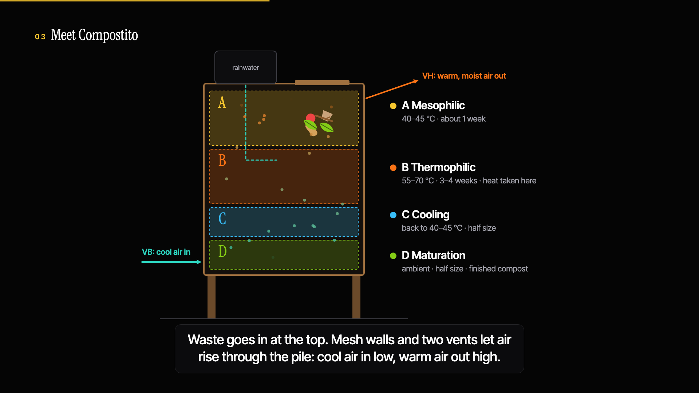
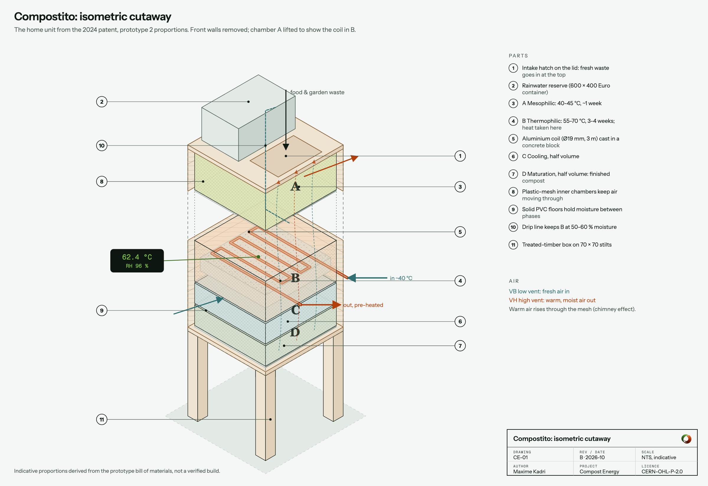
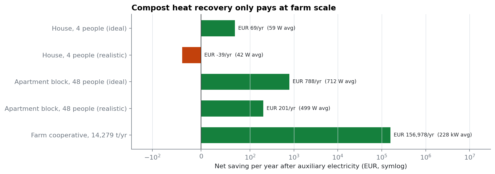
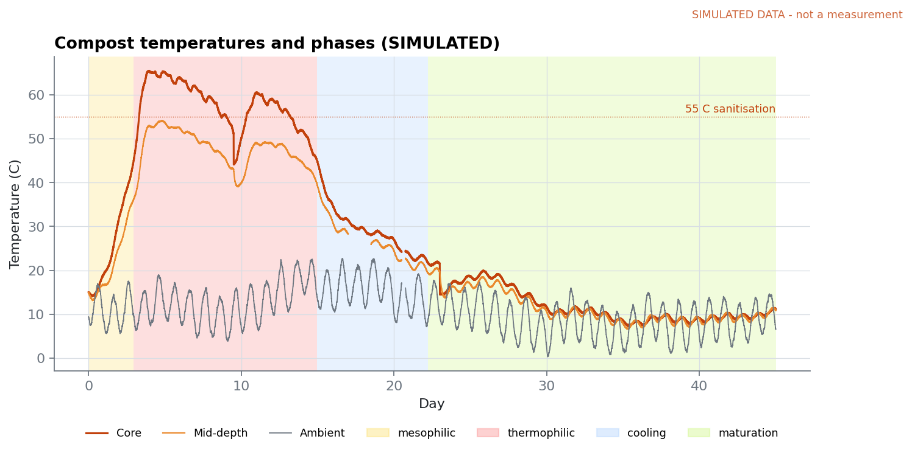
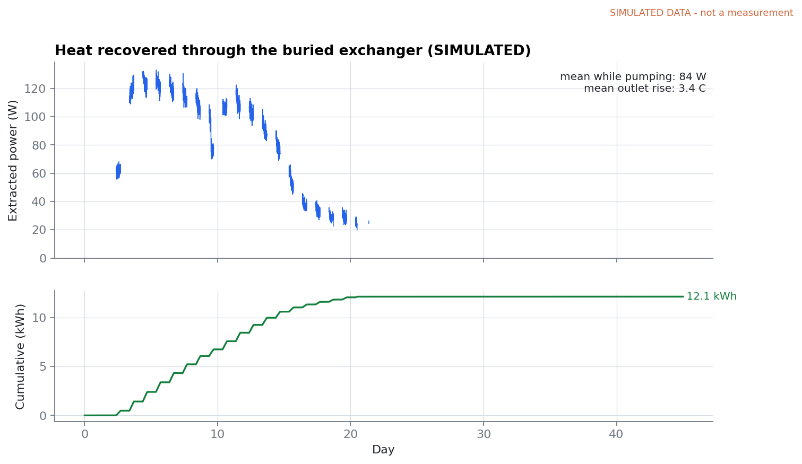
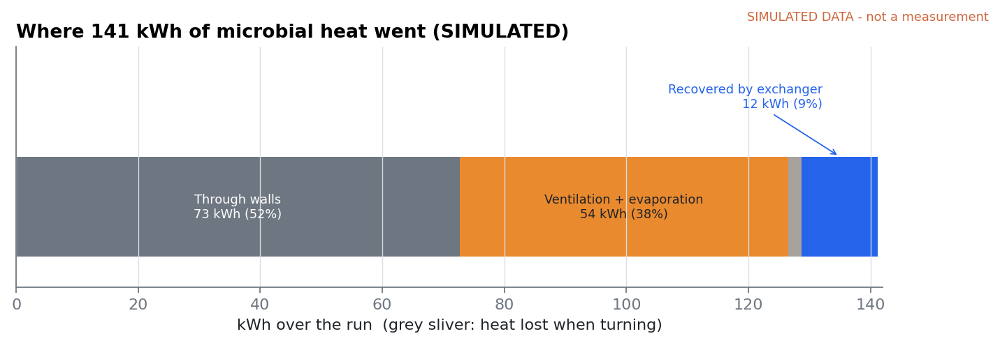
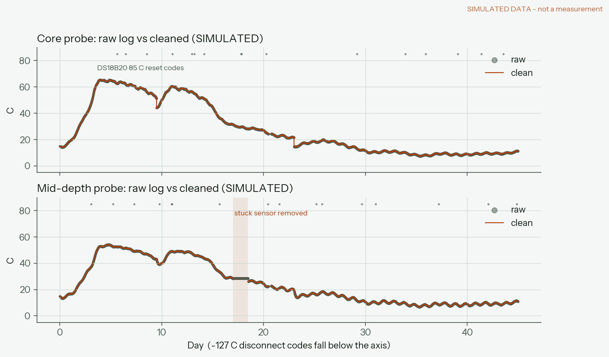
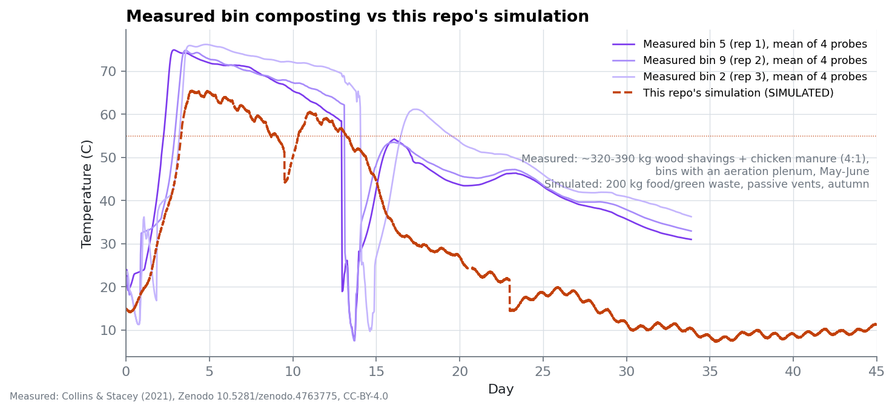
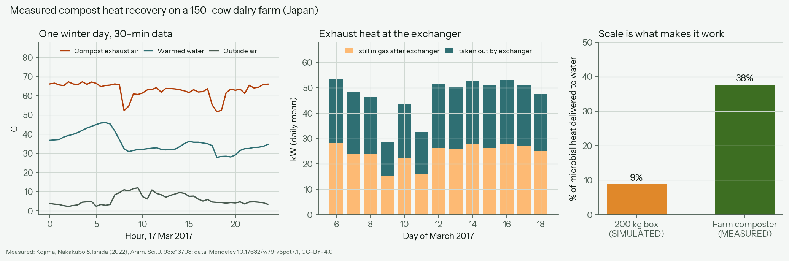

<p align="center">
  <picture>
    <source media="(prefers-color-scheme: dark)" srcset="assets/brand/white_on_trans.png">
    
  </picture>
</p>

# Compost Energy

**Open hardware for recovering heat from compost.** A "biological boiler" composts each phase in its own chamber and draws heat from the thermophilic core through a buried water loop, which pre-heats an existing heating system.

This repo contains the full engineering record: the (now open) patent, the system design, an energy model at three scales, a physics simulation of a prototype run, the data pipeline that will process real logger data, and the logger firmware.

## Watch: how Compostito works (2.5 min)

[](video/compostito-explainer.mp4)

Composting, aerobic vs anaerobic, the four-chamber home unit, why the microbes get hot, the four phases, where the heat goes, and why aerobic compost makes a better fertiliser. Captioned, no voice ([script](video/narration-script.md), [subtitles](video/compostito-explainer.srt)). Rendered from code in [`video/src/`](video/src/).



More drawings (build drawing, exchanger coil, P&ID, farm layout): [`hardware/drawings/`](hardware/drawings/).

## The short version

1. **2024:** designed a home unit that turns food scraps into heating and fertiliser. Wrote a provisional patent, specified three prototypes (~€640 BOM) and sized the heat exchanger.
2. **The numbers didn't work for homes.** A household's waste is worth **~59 W** of heat on average. A 50 W fan and controller make it net-negative, and the exchanger had been over-estimated ~70× by one wrong assumption ([details](docs/heat-exchanger.md)).
3. **They do work at farm scale.** About 14,000 t/yr of farm feedstock yields **~2 GWh/yr** of heat, worth **~€157k/yr net**. Microbial heat grows with volume while losses grow with surface area. → [pivot.md](docs/pivot.md)



## Simulated prototype run

> ⚠️ **Everything in this section is SIMULATED.** Nothing here was measured. The data comes from a physics model of a 200 kg insulated prototype ([`simulate.py`](model/compost_energy/simulate.py)), with realistic sensor faults injected. It shows what the prototype should do if the physics is right, and it exercises the same pipeline that real logger data will go through. Real runs will go in [`data/measured/`](data/measured/).

The model: two microbial populations (mesophilic + thermophilic) with cardinal-temperature kinetics, first-order substrate decay, a lumped energy balance (walls, buoyant ventilation, turning losses) and an effectiveness-NTU exchanger. Energy is conserved to machine precision (tested).

| | |
|---|---|
|  |  |

- Core reaches **65 °C** by day 3, stays above 55 °C for **8.5 days** (enough for pathogen kill), re-heats after the day-9.5 turning, and matures to ambient.
- The loop recovers **12.4 kWh over 45 days**: about 84 W while pumping, with a 3.4 °C outlet rise at 0.35 L/min.
- **Only ~9% of the microbial heat is recovered.** The rest leaves through the walls and vents:



**Data cleaning.** The raw log includes DS18B20 error codes (−127/85 °C), a sensor stuck for 1.5 days, flow-meter spikes, logger power cuts, duplicate rows and out-of-order timestamps. The pipeline removes them and leaves long gaps empty rather than inventing data. Energy computed from the cleaned noisy log: **12.42 kWh, against 12.41 kWh true** (0.1% error).



## Checked against real measurements

The simulation is only useful if it matches reality, so this repo also includes two published, openly licensed (CC-BY-4.0) datasets **measured by other research groups**. They are included unmodified with full attribution in [`data/reference/`](data/reference/). They are not Compost Energy measurements.

**Bin scale.** These are temperature logs from three ~320-390 kg compost bins (Collins & Stacey, 2021). The real bins run hotter and stay hot longer than the simulation (peak 75-76 °C vs 65 °C; 10-14 days above 55 °C vs 8.5). Manure-rich feedstock and an aeration plenum are the likely reasons, so the simulated box is conservative. The data also had a real sensor fault: a probe reading a fixed 537 °C for two days. The repo's cleaning rules removed it, and the data showed that the "stuck sensor" rule doesn't suit coarse-resolution loggers.



**Farm scale.** This is an enclosed composter on a 150-cow dairy farm with an exhaust-air heat exchanger (Kojima et al., 2022). **38% of the microbial heat reached the water** (23.3 of 61.8 kW), against ~9% in the simulated 200 kg box. That measured gap is the scale effect behind the [pivot](docs/pivot.md). The facility also drew 13.3 kW of electricity for aeration and agitation, which is the cost side the energy model accounts for.



## Repository

```
docs/
  patent/            2024 provisional patent: French original + English translation
  system-design.md   chambers, process conditions, heat path, prototypes
  energy-model.md    house / apartment block / farm energy balance
  heat-exchanger.md  the 2024 calculation, what was wrong, design consequences
  pivot.md           why home units were dropped for farm scale
  farm-unit.md       the farm-scale unit: tunnels, heat recovery, controls, operating modes
hardware/
  bom/               prototype 1-3 bill of materials
  drawings/          CE-01..11: home unit, prototype, farm-scale unit, P&IDs, controls (generated)
  logger/            ESP32 + DS18B20 logger firmware and wiring (not yet built)
model/
  compost_energy/    energy_balance, heat_exchanger, industrial, simulate, clean
  scripts/           run_scenarios, simulate_run, analyze_run
  tests/             28 tests: scenario numbers, energy conservation, cleaning, reference data
video/               explainer video, subtitles, script; src/ renders it frame by frame
data/
  simulated/         raw_run_01.csv (noisy log), clean_run_01.csv, truth, ledger, report
  measured/          real runs go here
  reference/         third-party measured datasets (CC-BY-4.0), with citations
figures/             generated
```

## Reproduce

```bash
python3 -m venv .venv && .venv/bin/pip install -e "model[test]"
.venv/bin/python model/scripts/run_scenarios.py                 # energy model + exchanger figures
.venv/bin/python model/scripts/simulate_run.py                  # writes data/simulated/raw_run_01.csv
.venv/bin/python model/scripts/analyze_run.py data/simulated/raw_run_01.csv
.venv/bin/python model/scripts/compare_reference.py             # vs published measurements
.venv/bin/python -m pytest model/tests
```

## Roadmap

- [ ] Build prototype 2 and the logger; first measured run in `data/measured/`
- [ ] Prototype 3 (double exchanger length): measure how output scales with area
- [ ] Fit the simulation's kinetic and loss parameters to measured data (start with the Collins bins)
- [x] Dimensioned drawings and coil layout ([drawings/README](hardware/drawings/README.md)); re-dimension after the first build
- [ ] Farm-scale concept: reactor and conveyor design, exhaust-air heat recovery

## License

Hardware CERN-OHL-P v2 · docs and data CC-BY-4.0 · code MIT · the logo is not licensed. See [LICENSE.md](LICENSE.md).

Maxime Kadri, physics (Lyon). Designed in 2024; opened in 2026.
