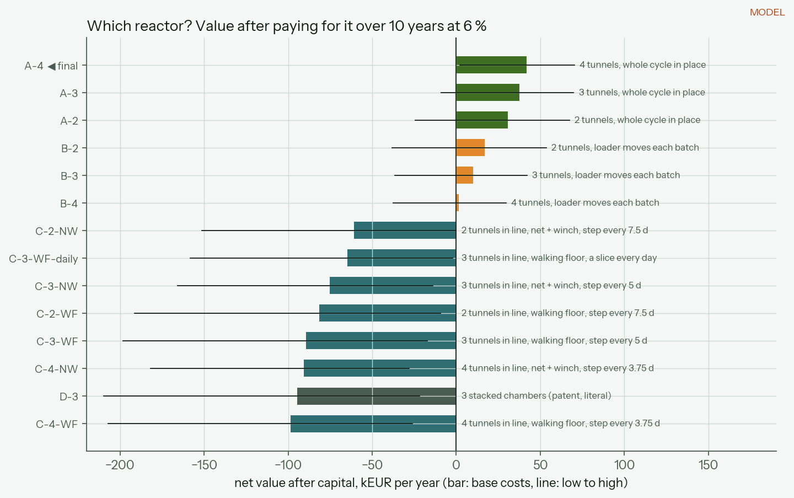
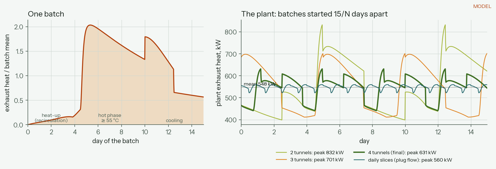

# Which reactor? The configuration study

The farm scenario ([energy-model.md](energy-model.md)) fixes how much heat there is: about 2 GWh a year, 548 kW on average over the heating season. This page compares the ways of building the reactor that recovers it. All of it is in [`configurations.py`](../../model/compost_energy/configurations.py) and the run script [`run_configurations.py`](../../model/scripts/run_configurations.py), which writes [`data/model/configurations.json`](../../data/model/configurations.json).

**Everything here is MODEL.** The capital costs are first-pass estimates with low/base/high values, not quotes. Nothing at this scale has been built.

**Result: four tunnels, each running the whole 15-day cycle in place, started 3.75 days apart (A-4).** It is the base design from now on. The options it beat are kept below as the trail.

## The options

| Code | What it is |
|---|---|
| **A-2, A-3, A-4** | 2–4 tunnels side by side. Each batch stays in one tunnel for all 15 days; the phase changes by changing the air. A wheel loader fills and empties one tunnel every 15/N days. |
| **B-2, B-3, B-4** | Same tunnels, one phase per tunnel. Every 15/N days the loader moves each batch one tunnel along, hot, through the open air. |
| **C-N-WF, C-N-NW** | **Automatic transfer train.** N tunnels end to end, insulated doors between them. You only fill tunnel 1; the bed moves to the next tunnel inside the building. WF: an aerated walking floor (hydraulic slats) in every tunnel. NW: a floor net pulled out by a winch onto a travelling filling head, as mushroom-compost tunnels are emptied and filled. A remix reel at each internal door breaks up the bed and re-wets it with condensate. |
| **C-3-WF-daily** | The same train advancing a slice every day instead of a whole batch every 5 days: plug flow. |
| **D-3** | The 2024 patent taken literally: three chambers stacked in a tower, material dropping floor to floor. |

## What is compared

1. **The shape of the exhaust heat.** One batch is simulated with the temperature model of [`simulate.py`](../../model/compost_energy/simulate.py) under the tunnel controller: heat-up on recirculated air, the hot phase held at 60 °C, cooling to 45 °C from day 10. The plant's exhaust is the sum of its staggered batches. The peak sets the exchanger and biofilter size; the swing sets the **hot-water buffer** a heat user needs to get a flat supply.
2. **The building:** walls, roof, aerated floor, doors, wall losses, footprint.
3. **Moving the material:** tonnes a day through the loader, diesel, operator time, hot moves in the open, and the heat they release.
4. **Equipment:** blowers (each sized for the largest load it sees), exchanger, biofilter, buffer tank, controls, and the transfer machinery.
5. **Money:** capital repaid over 10 years at 6 %, equipment upkeep (1 %/yr civil, 5 %/yr mechanical), and the operating differences against the farm scenario's €157k/yr.

## Results (base costs)

| Option | Value after capital, k€/yr | Capex | Peak / mean | Buffer | Loader t/day |
|---|---|---|---|---|---|
| **A-4** | **42.0** | €676k | 1.15 | 85 m³ | 67 |
| A-3 | 37.7 | €697k | 1.28 | 263 m³ | 67 |
| A-2 | 30.5 | €735k | 1.52 | 440 m³ | 67 |
| B-2 | 16.9 | €734k | 1.52 | 440 m³ | 99 |
| B-3 | 10.2 | €696k | 1.28 | 263 m³ | 132 |
| B-4 | 1.6 | €668k | 1.15 | 85 m³ | 165 |
| C-2-NW | −60.9 | €1.21M | 1.52 | 440 m³ | 39 |
| C-3-WF-daily | −64.8 | €1.25M | 1.02 | 4 m³ | 39 |
| C-3-NW | −75.2 | €1.27M | 1.28 | 263 m³ | 39 |
| C-3-WF | −89.5 | €1.39M | 1.28 | 263 m³ | 39 |
| D-3 | −94.7 | €1.51M | 1.28 | 263 m³ | 39 |

The full table at low, base and high costs is printed by the script and stored in the JSON. A-4 ranks first in all three cost cases (low €70k/yr, A-3 a hair behind; high €2k/yr).

## Why four tunnels whole-cycle-in-place wins

- **More batches in flight means a steadier exhaust.** With 2 tunnels the plant swings between 0.7 and 1.5× its mean; with 4 it stays between 0.8 and 1.15×. The exchanger shrinks (249 m² against 277 for A-3 and 329 for A-2) and the buffer tank most of all: 85 m³ against 263 m³ and 440 m³.
- **The extra tunnel costs less than the steadiness saves.** A fourth bay adds a door, a blower, controls and two end walls, about €40k, and saves about €70k of buffer tank and exchanger.
- **Nothing hot moves in the open.** The loader only fills fresh feedstock and empties finished compost.
- **One tunnel can be serviced while three run.**

**It is close.** A-3 wins if the feedstock composts faster or slower than assumed (first-order rate 0.15 or 0.05 /day instead of 0.10), or if it goes in warm (25 °C). If the heat user can follow the swings without a buffer, A-2 wins. The margin between A-3 and A-4 is under €10k/yr either way. A pilot that measures one batch's heat curve settles it.

## Why moving the material loses

**Loader transfer (B).** Every hot move costs loader time and diesel and releases heat outside: 28 kW with four tunnels, an upper bound. B-4 moves 165 t/day against 67 t/day for A-4. B only catches up if remixing a batch at each move raises the heat recovered by about 12 % (B-3).

**The automatic transfer train (C)** was engineered to remove the loader from everything except tipping fresh feedstock into a hopper:

- Tunnels in line; insulated guillotine doors between them; an aerated walking floor or a floor net + winch in each.
- A PLC runs each move from the outlet backwards: empty the last tunnel onto the outlet conveyor, move every bed one tunnel along, refill tunnel 1 from the hopper.
- A move is allowed only when the downstream tunnel is empty, the batch has met its phase criterion (the hot tunnel: ≥ 55 °C for 3 days), door and slat positions agree, and hydraulic pressure shows no jam. If a move fails, the batch keeps composting where it is.
- Each tunnel holds one phase, so each blower is sized for that phase only. In daily mode the exhaust is almost flat: buffer 4 m³, exchanger 230 m², installed fans halved.

It costs €450–700k more than plain tunnels (walking floors at ~€1,300/m², or winches, nets and a filling head; hopper; conveyors; remix reels) and saves only about €4k a year, because the loader work it replaces is small: 35 minutes and 17 L of diesel a day, €19k a year in all. One euro of equipment costs about €0.19 a year once repaid and maintained, so automation has to cost under ~€100k to pay from loader savings alone. It ends about €100k/yr behind A-4. To break even, remixing at each transfer would have to raise the heat recovered by 40–49 %, for which there is no evidence.

Automation would come back into play at a plant several times larger (loader work grows with tonnage, a winch does not), where no loader or operator is available, or where a permit forbids moving hot material in the open.

**The stacked tower (D)** is the patent's chamber-per-phase idea at full scale. Gravity does the moving, but a multi-storey structure carrying 1.7 t/m² of wet compost per floor, drop floors that must work in hot ammonia-laden air, and deeper, compacting beds make it the most expensive option (€1.5M, about €137k/yr behind A-4). At farm scale the patent's phases become a control scheme: each tunnel passes through them in time instead of in space.

## Assumptions to check on a pilot

| Assumption | Value | Where |
|---|---|---|
| First-order degradation rate at optimum | 0.10 /day (0.05–0.15) | `BatchProcess.k_max_per_day` |
| Heat-up on recirculated air, damper band | 15 % of heat leaves, 8 K band | `BatchProcess` |
| Hot phase / cooling setpoints | 60 °C until day 10, then 45 °C | `BatchProcess` |
| Buffer sized to flatten fully to the mean | upper bound | `evaluate_option` |
| Unit costs | low/base/high, EUR 2026 installed | `Costs`, `LOW`, `HIGH` |
| Remix boost | 0 (break-even reported) | `break_even_boost` |
| Loader diesel, speed, heat lost per hot move | 0.25 L/t, 120 t/h, 10 K | `industrial.Handling` |

Capex covers the tunnels, aeration, heat recovery, buffer, biofilter and controls. It leaves out the maturation hall, feedstock storage, the heat main to the user, site works and engineering.
