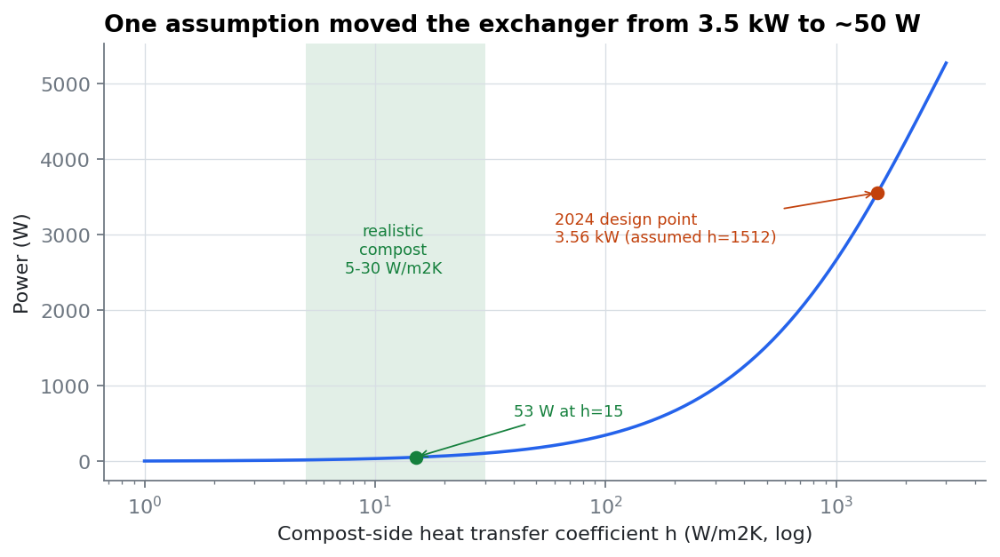

# Heat exchanger: the 2024 calculation and what was wrong with it

Code: [`model/compost_energy/heat_exchanger.py`](../model/compost_energy/heat_exchanger.py)

## The 2024 design calculation

The first prototype exchanger was one aluminium tube, 19 mm in diameter and 3 m long, buried in the compost core. The original spreadsheet sized it with a series-resistance model:

```
1/U = 1/h_compost + wall/k_aluminium + 1/h_water
P   = U · A · (T_compost − T_water)
```

| Input | Value |
|---|---|
| Surface A = π · 0.019 · 3 | 0.179 m² |
| Wall thickness, k_aluminium | 3 mm, 237 W/m·K |
| h_water (flowing hot water) | 3000 W/m²K |
| **h_compost** | **1512.5 W/m²K** (taken as half water, half air) |
| T_compost / T_water | 60 °C / 40 °C |
| **Result** | U = 993 W/m²K, **P = 3.55 kW** |

The code reproduces this exactly (`ORIGINAL_2024`), and a test pins the result.

## What was wrong

The arithmetic is right, but one input isn't. 1500 W/m²K is the kind of film coefficient you get from a liquid flowing past a surface. Compost is a damp, porous solid that barely moves. Heat reaches the pipe mostly by **conduction** through material with k ≈ 0.2-0.7 W/m·K, plus some slow air and vapour movement. The realistic effective coefficient is roughly **5-30 W/m²K**.

Because the three resistances are in series, the largest one dominates. With realistic numbers the compost side is ~99% of the total resistance, so the aluminium and the water barely matter:



| h_compost (W/m²K) | Power at 60/40 °C |
|---:|---:|
| 5 | 18 W |
| 15 | 53 W |
| 30 | 106 W |
| 1512.5 (2024 assumption) | 3,556 W |

There is also a second, independent ceiling: **an exchanger can't extract more heat than the microbes produce.** A 200 kg prototype pile peaks at a few hundred watts of microbial heat, and most of it leaves through the walls and vents (see the [simulated heat ledger](../figures/sim_run_01_heat_ledger.png)).

## Design consequences

1. **Surface area beats material.** Swapping aluminium for copper changes almost nothing. What helps is more pipe in contact with the compost, which is what the patent proposed (§8.2: smaller diameter, more parallel circuits). Prototype 3 doubles the tube length to measure exactly this.
2. **Bring the heat to the pipe.** Forced aeration, extracting heat from the exhaust air (air-to-water, as in the farm-scale design), or turning the material over the coil all raise the effective h far more than any pipe upgrade. Published measurements back this up. On a dairy farm, a 9.2 m² plate-fin exchanger in the composter's exhaust air removed a mean 22.6 kW, about **2.5 kW/m²**, against ~0.3 kW/m² for the buried pipe at realistic h. It also ran at a larger temperature difference, so this is an order-of-magnitude comparison ([data](../data/reference/README.md)).
3. **Measure at low flow.** At ~50-130 W, normal pump flows give an outlet rise below the sensor's accuracy. The logger runs at 0.35 L/min to get a 3-5 °C rise.
4. **Scale is the real fix.** Microbial heat grows with volume while wall losses grow with surface area. That's the physical reason the project [moved to farm scale](pivot.md).
