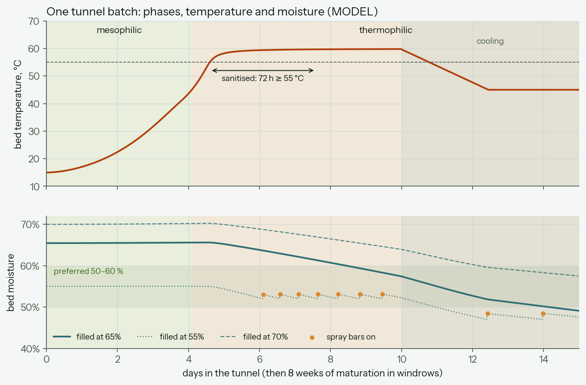

# Composting process

The tunnels are a composting plant first and a heat source second. This page is the process sheet for one batch: what goes in, which phase the bed is in and for how long, and how its moisture is held. It all comes from [`process.py`](../../model/compost_energy/process.py); [`run_process.py`](../../model/scripts/run_process.py) writes [`data/model/process.json`](../../data/model/process.json) and the figure below. Drawing [CE-14](../../hardware/drawings/farm-process-sheet.svg) puts it on one sheet.

**Everything here is MODEL**: literature feedstock values and the batch kinetics of [`configurations.py`](../../model/compost_energy/configurations.py). A pilot replaces them with its own lab results and logs.

## Why a batch spends only 15 days in a tunnel

Composting takes about **10 weeks** here, and only the first 15 days happen in a tunnel:

| | Where | Days | Bed | Share of the degradable matter broken down |
|---|---|---|---|---|
| Mesophilic | tunnel | 0 – 4.1 | 15 → 45 °C, air mostly recirculated | 10 % |
| **Thermophilic** | tunnel | **4.1 – 15** | **45 – 60 °C** | **55 %** |
| ↳ hot hold | | 4.6 – 10.8 | held at 60 °C | 39 % |
| ↳ sanitisation | | 4.6 – 7.6 | ≥ 55 °C for 72 h, unbroken | |
| ↳ cooling | | 10 – 15 | 60 → 45 °C on full fresh air | 15 % |
| Maturation (curing) | windrows | 15 – 71 | 45 °C → ambient, turned weekly | 35 % |

The tunnel holds the stage that needs to be enclosed:
- It is hot enough to sanitise the batch.
- It releases most of the heat (two thirds of the degradable matter is gone by day 15).
- It produces almost all of the ammonia and odour, so the exhaust goes through the exchanger and the biofilter.

Maturation needs none of that. What breaks down after day 15 does so over eight weeks at 25–45 °C, spread across about 1,200 m² of windrows. That heat is too cool and too diffuse to be worth piping. A tunnel day costs far more than a windrow day, so the tunnels take the batch only until it is sanitised, past its peak and cooled.

**How long the thermophilic phase lasts.** It lasts about 11 days here, of which about 6 are at 55–60 °C. In an open windrow the same phase drags on for weeks to months: the temperature can't be controlled, turning cools the pile, and the outside of the pile never gets hot. In a tunnel, the controller holds the bed at the temperature where it breaks down fastest, so the hot phase is short and complete. Cooling to 45 °C before emptying stops the batch steaming, and releasing ammonia, in the open.

**The slow start is a real cost.** Heating from 15 to 45 °C takes 4 days in the model, which is a quarter of the tunnel time. Two cheap fixes, to test on the pilot:
- Mix a few percent of hot compost from the tunnel being emptied into the fresh batch, as an inoculum.
- Keep the air fully recirculated until the bed passes 40 °C.

Industrial tunnels usually reach 55 °C within 1–2 days.

## The recipe

The farm cooperative's feedstock, by mass:

| Feedstock | Share | Moisture | C:N |
|---|---|---|---|
| Cattle manure with bedding | 70 % | 77 % | 18 |
| Spoiled grass/maize silage | 15 % | 65 % | 22 |
| Chopped straw | 15 % | 12 % | 75 |
| **Mix** | | **65 %** | **27** |

Straw is the control knob. More straw makes the mix drier, raises its C:N ratio and opens up its structure. Less straw makes it wetter, denser and richer in nitrogen, so it loses more ammonia.

## Process window

| Parameter | Target | Why | How it is held |
|---|---|---|---|
| C:N ratio | 25 – 35 (mix 27) | below: ammonia loss; above: slow | straw share at the mixer |
| Moisture at filling | 55 – 65 % | microbes need water films; above 65 % air can't pass | straw share; condensate or water at the mixer |
| Moisture, hot phase | ≥ 52 %, sprayed back to 56 % | below 45–50 % activity collapses | roof spray bars |
| Moisture, leaving the tunnel | 45 – 55 % | maturation needs water too | spray bars in the cooling phase |
| Moisture, maturation | 40 – 50 % | | water when turning |
| Oxygen | ≥ 5 % in the exhaust (10–15 % preferred) | anaerobic pockets smell and make methane | fresh-air damper overrides everything ([CE-10](../../hardware/drawings/farm-control.svg)) |
| Temperature | 60 °C hot hold, 45 °C at emptying | fastest breakdown near 55–60 °C; above 65 °C the microbes die back | blower speed and recirculation |
| Sanitisation | ≥ 55 °C for 72 h | French order of 22 April 2008 for forced-aeration composting (as summarised in a regional guide; check the official text); US EPA PFRP for in-vessel systems | timer restarts if any probe drops below |
| Bulk density at filling | ≤ 0.60 – 0.65 t/m³ | denser mixes lack free air space | straw; a bucket test at the mixer |
| Free air space | ≥ 30 – 40 % | air must reach the whole bed through the floor | |
| Particle size | 6 – 50 mm | | shredding the straw and silage |
| pH | 6.5 – 8.5 | | |

Sources for the windows are the on-farm composting handbooks (NRAES-54 and its extension summaries). The pilot measures its own feedstock: moisture by oven-drying, C and N by lab analysis, and bulk density with a bucket test.

## Water: what leaves, what comes back, when to add it

Each 147 t batch, filled at 65 % moisture:

| | t per batch |
|---|---|
| Water evaporated into the exhaust | 63 |
| Water formed by the microbes | 6 |
| Condensed again in the exchanger | 44 |
| Sprayed back on the bed (this recipe) | 0 |
| Moisture leaving the tunnel | 49 % |
| Mass leaving the tunnel | 54 % of the fresh mass |

**Heat recovery and drying are the same thing.** 92 % of the recovered heat is water vapour condensing on the coils, so every kWh recovered is water taken out of the bed. This recipe is wet enough to absorb that. A drier recipe is not:

| Filled at | Sprayed per batch | Leaving at |
|---|---|---|
| 70 % | 0 t | 58 % (too wet: the mix needs more straw) |
| 65 % (this recipe) | 0 t | 48 % |
| 60 % | 12 t | 47 % |
| 55 % | 27 t | 48 % |

**How water is added** ([CE-09](../../hardware/drawings/farm-process-pid.svg), [CE-14](../../hardware/drawings/farm-process-sheet.svg)):

1. **At the mixer, before filling.** If the mix is below 55 %, condensate or farm water goes on with the straw. This is the cheapest and most even way to add water.
2. **Roof spray bars in each tunnel (SP-10x).** Three bars of flat-fan nozzles along the tunnel roof, at about 6 m³/h per tunnel, each with its own solenoid valve (XV-10x) and flow meter (FT-10x). They spray while the blower runs at full flow, so the water spreads through the top of the bed instead of pooling.
3. **Condensate first, clean water after sanitisation.** Pump P-401 feeds the bars from the condensate tank TK-401 until the batch has had its 72 h at 55 °C. After that the bars switch to farm water. Condensate carries ammonia and comes off the whole plant's exhaust, so it would bring germs back onto a sanitised batch. Condensate the beds don't need goes to the slurry store, which is about 4,300 m³ a year in this model.
4. **When the bars come on.** Moisture can't be measured reliably inside a 3 m bed, so the PLC estimates it from a running water balance:
   - Water evaporated: exhaust airflow × the difference between exhaust and inlet humidity.
   - Water condensed: the condensate flow.
   - Water sprayed.
   
   The weight of each fill and a grab sample (oven-dried, or a squeeze test) correct the estimate. The bars come on below 52 % in the hot phase and below 47 % in the cooling phase.
5. **The bottom of the bed dries first.** Fresh air enters through the floor, warms up and picks up water in the lowest layer. Spraying wets the top. Air flows up through the bed, so the water spread over the top keeps the lowest layer from drying out. Alternating the airflow direction is not possible with a spigot floor, so the bars are the remedy.

## What this changes elsewhere

- **Mass leaving the tunnel.** The water balance gives 54 % of the fresh mass. The loader costs in `industrial.Handling` assume 70 %, which overstates the tonnes moved by the B and C options, so those options look slightly worse than they would. The configuration study's ranking doesn't change.
- **Bulk density: to settle before detailed design.** The tunnels are sized at 0.85 t/m³ (`energy_balance.farm_sizing`). A straw-amended manure mix should be at or below about 0.60–0.65 t/m³. If the real mix is 0.65 t/m³, a 147 t batch is 226 m³, not 173 m³. It would fill a 12.5 m tunnel to 3.6 m, which leaves no headspace in a 4 m tunnel. The tunnels would need to be about 16 m long at the same 2.8 m fill depth. In the configuration model that adds about €56k to the build cost and lowers the value after capital from €42k to €34k a year (MODEL). Four tunnels still win. A pilot measures the mix before the tunnel length is frozen.
- **Heat-up time.** At 4 days, it costs a quarter of the tunnel time. If inoculation brings it to 2 days, the same tunnels hold a 13-day cycle, or a batch can stay longer in the hot hold.

## Assumptions to check on the pilot

| Assumption | Value | Where |
|---|---|---|
| Feedstock moisture, C and N | literature (table above) | `Feedstock` |
| Inlet air | 5 °C, 85 % RH | `WaterModel` |
| Heat per kg of organic matter oxidised | 20 MJ/kg | `WaterModel.vs_mj_per_kg` |
| Water formed per kg oxidised | 0.6 kg | `WaterModel.metabolic_water` |
| Spray capacity | 6 m³/h per tunnel | `WaterModel.spray_m3_h` |
| Moisture setpoints | 52 → 56 % hot, 47 → 50 % cooling | `Targets` |
| Maturation | 8 weeks in windrows ≤ 1 m deep | `energy_balance.farm_sizing` |
